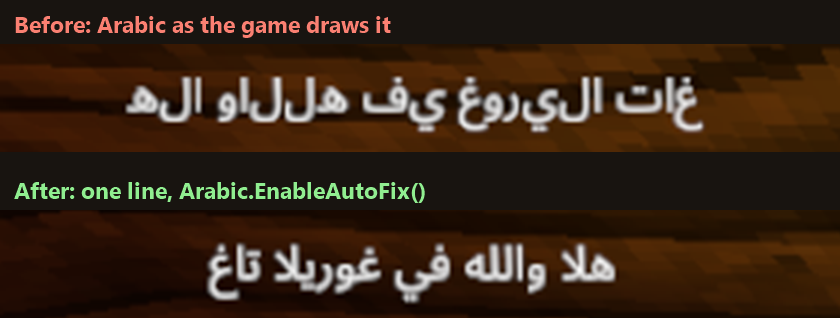

<h1 align="center">
  
</h1>

<p align="center"><b>Arabic that just works in Gorilla Tag.</b> · غوريلا حروف</p>



Gorilla Tag draws Arabic as separate letters, back to front. GorillaHurouf is a small BepInEx library that fixes it, for one text or for every text in the game with a single line.

- **Fixed Arabic:** joined letters, the right order, English and numbers mixed in, colour tags, wrapping.
- **Auto-fix:** one call and any text in the game that gets Arabic is drawn right.
- **Notifications:** Arabic messages in front of you, with colours.
- **Message of the day:** your own Arabic text and colour on the game's message-of-the-day board.
- **Translations:** English and Arabic strings from a JSON file.
- **Hijri date:** today's date, in Arabic.

It does nothing by itself: a mod has to call it.

## Install

1. Install [BepInEx 5](https://github.com/BepInEx/BepInEx/releases) for Gorilla Tag and run the game once.
2. Download `GorillaHurouf.dll` from the Releases page.
3. Put it in `Gorilla Tag\BepInEx\plugins`.

## Use it (for mod makers)

Reference `GorillaHurouf.dll` in your project and make your mod depend on it:

```csharp
[BepInDependency("dev.musaed.gorillahurouf")]
public class MyMod : BaseUnityPlugin { }
```

Then:

```csharp
using GorillaHurouf;

myText.SetArabic("هلا والله في غوريلا تاغ");                  // fix one text
Arabic.Notify("انحفظت الإعدادات", NotifyKind.Success);        // show a notification
Arabic.EnableAutoFix();                                       // or fix every text in the game
Arabic.SetMessageOfTheDay("يا هلا والله فيكم", Color.green);  // your text on the message-of-the-day board
```

Other calls: `Arabic.Fix(text)`, `Arabic.Wrap(...)`, `Arabic.Translator("MyMod")` for English and Arabic strings from a JSON file, `Arabic.Hijri()` for the Hijri date, `Arabic.SkipAutoFix(text)`. They are all in `Arabic.cs`, with a comment on each.

## Licence

The bundled font is Noto Sans Arabic (SIL Open Font License 1.1, in `Fonts/OFL.txt`). The licence for the library itself is not chosen yet.
